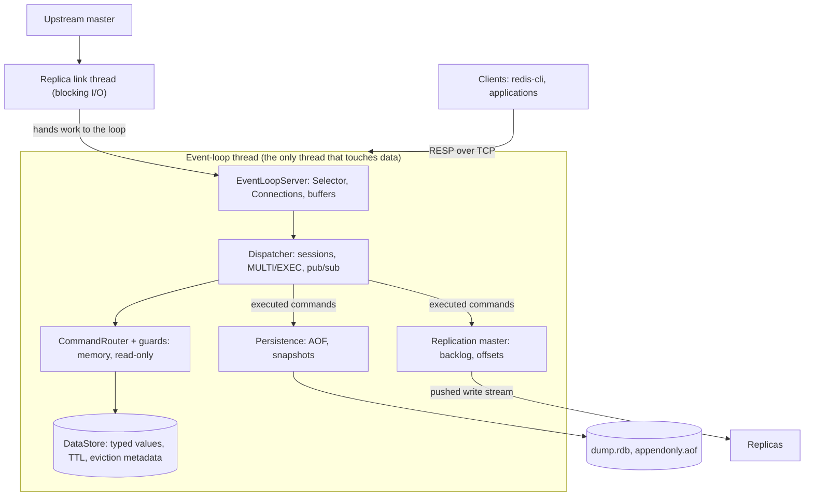

# Reddis


**An in-memory data store written from scratch in Java 21.** It speaks the Redis protocol (RESP2), so `redis-cli`,
`redis-benchmark` and standard Redis client libraries work against it. No runtime dependencies (JUnit is test-only).

## Highlights

- **Single-threaded NIO event loop** (`Selector`, non-blocking sockets), pipelining, partial reads/writes, backpressure
- **Data types:** strings, lists, hashes, sets, sorted sets (a hand-written **skip list with spans**)
- **Expiry:** lazy + active, stored as absolute deadlines
- **Persistence:** RDB-style snapshots (CRC32, atomic replace) and an append-only file (always / everysec / no fsync,
  torn-write recovery, compaction)
- **Memory limit + 8 eviction policies**, approximated LRU/LFU by sampling (like Redis)
- **Pub/Sub** with glob patterns, **MULTI/EXEC/WATCH** transactions
- **Master-replica replication** with full and partial resync (backlog), read-only replicas, `REPLICAOF`
- **N tests** including model-based randomized tests, a coverage gate, and CI with an end-to-end smoke test against
  the real `redis-cli`

## Architecture



| Layer | Package | Responsibility |
|---|---|---|
| Network | `server` | accept, read, write, buffers, backpressure |
| Protocol | `protocol` | RESP parsing (incremental) and encoding |
| Session | `session` | per-connection state, transactions, pub/sub, WATCH |
| Command | `command` | one class per command, command spec table, guards |
| Storage | `storage` | typed values, expiry, memory accounting, eviction sampling |
| Persistence | `persistence` | snapshots, AOF, recovery |
| Eviction | `eviction` | maxmemory policies |
| Replication | `replication` | master/replica roles, PSYNC, backlog |

## Quick start

```bash
mvn clean verify                       # build and run all tests
java -jar target/reddis-<version>.jar  # listens on 6379
redis-cli
127.0.0.1:6379> SET greeting hello
OK
127.0.0.1:6379> INCR visits
(integer) 1
```

Master and replica on one machine:
```bash
java -jar target/reddis-<version>.jar 6379 --dir data-master
java -jar target/reddis-<version>.jar 6380 --dir data-replica --replicaof 127.0.0.1 6379
```

## Options

| Option | Meaning |
|---|---|
| `[port]` | listening port (default 6379) |
| `--dir <path>` | where `dump.rdb` and `appendonly.aof` live |
| `--appendonly yes\|no` | enable the append-only file |
| `--appendfsync always\|everysec\|no` | AOF durability vs speed |
| `--save-interval <s>` | automatic background snapshot if data changed |
| `--maxmemory <size>` / `--maxmemory-policy` / `--maxmemory-samples` | memory limit and eviction |
| `--replicaof <host> <port>` / `--repl-backlog-size` | replication |
| `--blocking` | legacy thread-per-client server, a benchmark baseline only |

## Supported commands

- **Connection / server:** PING, ECHO, SELECT (0), HELLO (RESP2), CLIENT SETNAME/SETINFO/GETNAME, COMMAND, TIME, INFO, CONFIG GET/SET (memory settings), DBSIZE, SAVE, BGSAVE, LASTSAVE, REWRITEAOF
- **Keys:** DEL, EXISTS, TYPE, KEYS, RENAME, FLUSHALL, FLUSHDB, EXPIRE, PEXPIRE, EXPIREAT, PEXPIREAT, TTL, PTTL, PERSIST, MEMORY USAGE, OBJECT IDLETIME/FREQ
- **Strings:** SET (EX, PX, NX, XX), GET, MSET, MGET, INCR, DECR, INCRBY, DECRBY, APPEND, STRLEN
- **Lists:** LPUSH, RPUSH, LPOP, RPOP, LLEN, LRANGE, LINDEX
- **Hashes:** HSET, HGET, HDEL, HGETALL, HLEN, HEXISTS
- **Sets:** SADD, SREM, SMEMBERS, SISMEMBER, SCARD
- **Sorted sets:** ZADD, ZSCORE, ZRANK, ZREM, ZCARD, ZRANGE, ZREVRANGE, ZINCRBY
- **Pub/Sub:** SUBSCRIBE, UNSUBSCRIBE, PSUBSCRIBE, PUNSUBSCRIBE, PUBLISH
- **Transactions:** MULTI, EXEC, DISCARD, WATCH, UNWATCH
- **Replication:** REPLICAOF/SLAVEOF, ROLE, PSYNC, REPLCONF

## Design decisions worth reading

All 33 decisions are recorded in [`docs/02-design.md`](docs/02-design.md). A few highlights:
- ADR-15: why one thread (atomic commands and transactions without locks)
- ADR-19: the AOF stores *effects* with absolute deadlines, flushed before replies (group commit)
- ADR-22: approximated LRU/LFU by sampling, with an O(1) random-access key index
- ADR-28/29: replication reuses the AOF record stream and the snapshot codec; the replica network thread hands work to the loop

## Testing

`mvn verify` runs N unit and integration tests (real sockets, real files, two servers replicating) plus a JaCoCo coverage
gate. Randomised tests compare the skip list and the memory accounting against reference models. CI also runs
[`scripts/smoke-test.sh`](scripts/smoke-test.sh) against the packaged jar with the real `redis-cli`, including a
`kill -9` crash-recovery check. See [`docs/04-test-report.md`](docs/04-test-report.md).

## Performance

See [`docs/benchmarks.md`](docs/benchmarks.md): event loop vs virtual threads vs real Redis, the cost of each fsync
policy, and eviction hit rates.

## Project documents

Requirements ([`docs/01`](docs/01-requirements.md)), design and ADRs ([`docs/02`](docs/02-design.md)), one sprint plan per
module ([`docs/sprints`](docs/sprints)), test report, benchmarks, [`CHANGELOG.md`](CHANGELOG.md).

## Limitations

RESP2 only, one database, no AUTH/TLS, no Lua scripting, no Streams, no Cluster, no `SCAN`, no chained replication.
Transactions are not wrapped in MULTI/EXEC in the AOF. `KEYS` and `REWRITEAOF` block the event loop.

## What I learned

TCP framing and non-blocking I/O, `ByteBuffer` state, skip lists, durability (`fsync`, atomic rename, torn writes),
cache eviction policies, optimistic locking, replication offsets and histories, and how to keep a single-writer design
correct while other threads do the I/O.